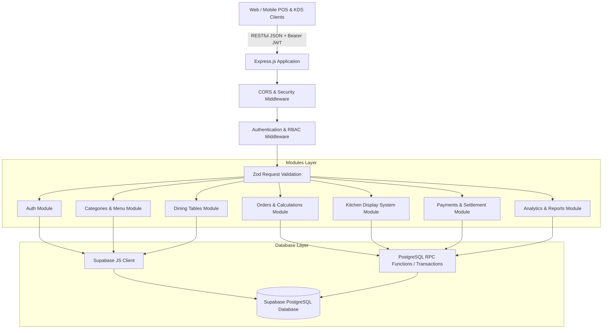

# System Architecture

## Overview
The **Smart Restaurant & Café POS + Live Kitchen Display System Backend API** is engineered using a modular layered architecture in Node.js (ES Modules) and Express.js, integrated with Supabase PostgreSQL and Role-Based Access Control (RBAC).

## Architectural Principles
1. **Modular Layered Architecture**: Modules (`auth`, `categories`, `menu`, `tables`, `orders`, `kds`, `payments`, `reports`) encapsulate their respective routes, controllers, services, and validation schemas.
2. **Atomic Concurrency Protection**: High-concurrency operations (such as table reservation upon dine-in order creation and payment settlement releasing tables) execute via atomic PostgreSQL RPC stored functions with row-level locks (`FOR UPDATE`).
3. **Server-Side Financial Integrity**: Prices, add-ons, discounts, taxes (15%), and grand totals are calculated strictly server-side using verified database records.
4. **Resilient Dual-Mode Execution**: The system supports live Supabase PostgreSQL execution with automatic in-memory fallback for high-speed automated unit/integration testing without network dependencies.
