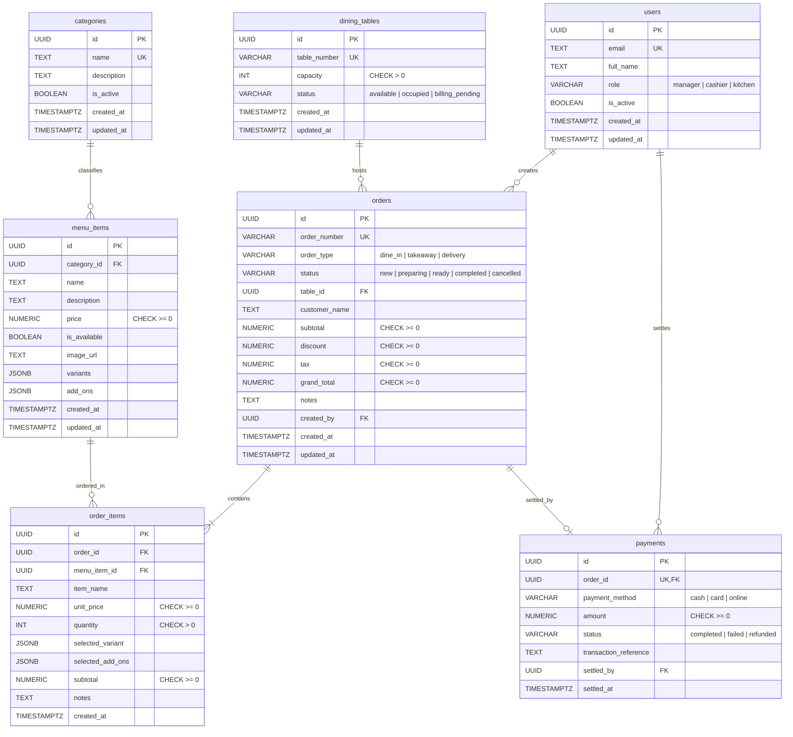

# Database Schema & Relational Model

The database is built on Supabase PostgreSQL with 7 primary relational tables, comprehensive foreign key constraints, check constraints, performance indexes, and transactional RPC functions.

## Atomic RPC Functions
1. `create_order_atomic(p_order_type, p_table_id, p_customer_name, p_items, p_notes, p_discount, p_created_by)`:
   - Validates and row-locks table if `dine_in`.
   - Validates menu items availability and fetches current prices.
   - Calculates financial totals (subtotal, 15% tax, discount, grand total).
   - Inserts order and order items preserving historical pricing.
   - Atomically transitions table status to `occupied`.
2. `settle_payment_atomic(p_order_id, p_payment_method, p_amount, p_settled_by, p_transaction_ref)`:
   - Locks order row.
   - Verifies amount equals order grand total.
   - Records payment and prevents duplicate settlement.
   - Transitions order status to `completed`.
   - Atomically releases linked dining table (`available`).
3. `update_order_status_atomic(p_order_id, p_new_status)`:
   - Enforces valid transition pipeline (`new` -> `preparing` -> `ready` -> `completed`).
4. `get_sales_report_summary(p_start_date, p_end_date)`:
   - Aggregates settled revenue, orders count, breakdown, and top 5 items.
